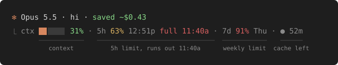
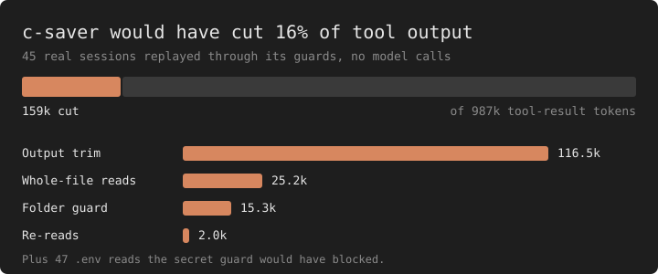

# c-saver

[](LICENSE)


Spend fewer tokens in [Claude Code](https://claude.com/claude-code) without changing how you work.



Every API call re-sends your CLAUDE.md, tool schemas and the whole conversation.
c-saver cuts noisy tool output before Claude reads it, blocks reads that only waste context,
and warns you on the status line before a session gets expensive. One plugin, no dependencies, no daemon.

## Install

In Claude Code:

```
/plugin marketplace add pianburp/c-saver
/plugin install c-saver@pianburp
/saver-setup --yes
```

Restart Claude Code. Run `/saver-setup` without `--yes` first to see what it changes in `settings.json`.

## What it saves



119 real sessions (14 projects, one month) were replayed through c-saver's guards, with no model calls.
The chart covers the 45 sessions that showed no sign of c-saver.
In the 74 that ran with it, the mod's own notes record 137 output trims cutting 208k tokens.

A cut token also stays out of every later call, so the real saving is larger than the chart.
Limits: one person's sessions, counted as `chars / 4`. [Method and full numbers](docs/reference.md#proof).

Measure your own sessions. It prints counts only, never their content:

```sh
node bench/replay.ts
```

## What you get

- **Status line:** context, usage limits with a run-out forecast, and a prompt cache countdown. It tells you when to `/compact` or `/clear`.
- **Output trim:** a shell output over 2k tokens is cut to its head, error lines and tail.
- **Read guards:** no reads of `node_modules`, build folders, lockfiles, minified or huge files, or unchanged files read twice.
- **Secret guard:** blocks `.env` reads and API keys written into code.
- **Auto-compact at 50%** instead of near full.
- **`/token-audit`:** lists what loads before you type and proposes cuts.
- **`/savings`:** what each saver saved this session.

Also: focus mode, `/handoff`, `/wrapped`, a pet, and an on/off switch for everything.
See the [full reference](docs/reference.md).

## License

[MIT](LICENSE)
