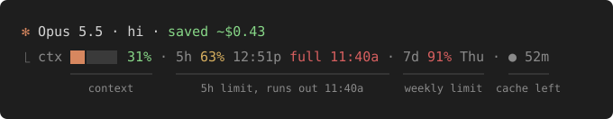
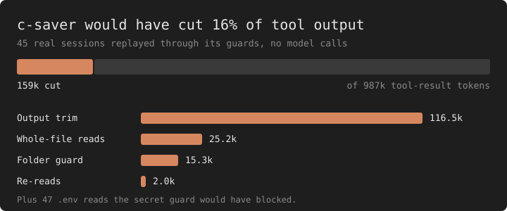

# c-saver

[](LICENSE)

**Keep coding sessions lean with c-saver.** c-saver keeps noisy file reads out of the conversation, helps you see what takes up context, and saves handoffs between sessions. It runs as a plugin in Claude Code and Codex.

## Install

### Claude Code

Run these commands in Claude Code.

```
/plugin marketplace add pianburp/c-saver
/plugin install c-saver@pianburp
/saver-setup --yes
```

Restart Claude Code. Run `/saver-setup` without `--yes` to preview the settings changes. The plugin includes custom output trimming, a status line, and a session savings report. [Claude Code guide](docs/reference.md)



### Codex

Use Node.js 24+ and a Codex CLI with `codex plugin` support. Run these commands from the root of the c-saver checkout.

```sh
codex plugin marketplace add .
codex plugin add c-saver@c-saver-local
codex plugin list --marketplace c-saver-local
```

Start a fresh Codex session and ask it to use the `c-saver-audit` skill. To enable shell read guards, launch Codex with `C_SAVER_CODEX_GUARDS=1` and review and trust the bundled hook in `/hooks`.

```powershell
$env:C_SAVER_CODEX_GUARDS = '1'
codex
```

In Bash or Zsh, run `C_SAVER_CODEX_GUARDS=1 codex`. The plugin also includes offline usage reporting and worktree handoffs. [Codex guide](docs/codex.md)

## What c-saver saves

- In a replay of 45 Claude Code sessions, c-saver would have removed about **159,000 of 987,000 tool-result tokens** (16%), using an estimate of one token per four characters. [Claude Code replay](docs/reference.md#proof)
- In two paired Codex CLI fixture tests, c-saver reduced the next request's tool-result text from **1,395 to 40 tokens** for a generated build log and from **12,022 to 40 tokens** for a large whole-file read. These counts cover the individual reads. [Codex benchmark](docs/codex-verification.md#paired-guard-benchmark)



## Support

Report bugs in [GitHub issues](https://github.com/pianburp/c-saver/issues). Include your OS, client version, and c-saver version.

## License

[MIT](LICENSE)
